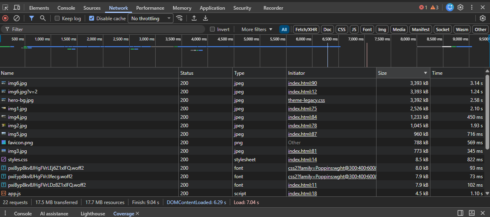
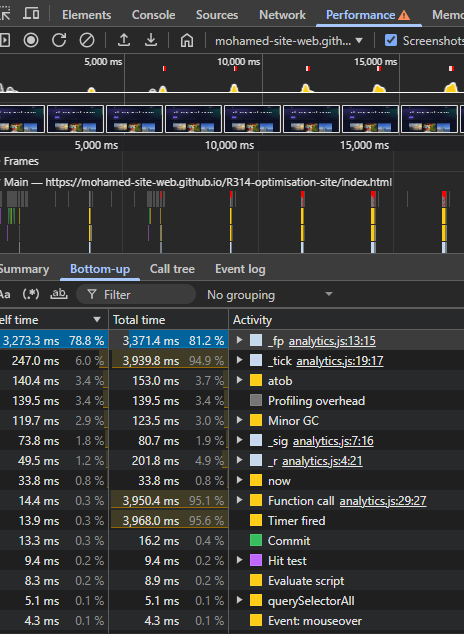
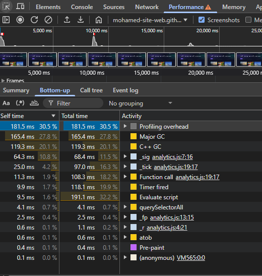
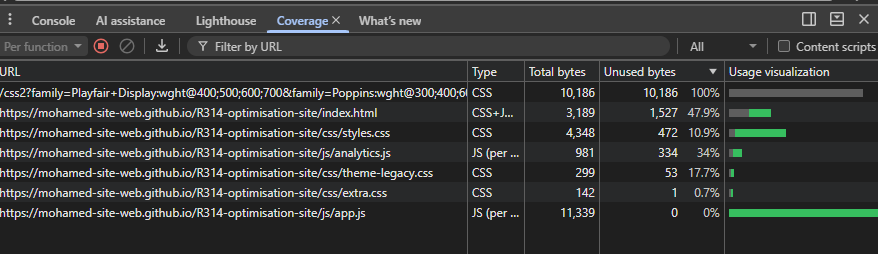
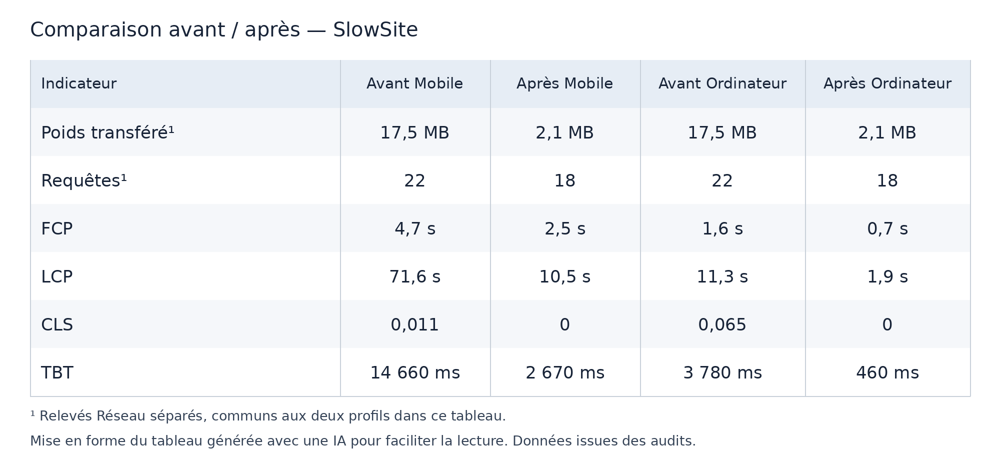
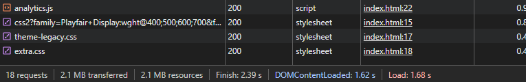
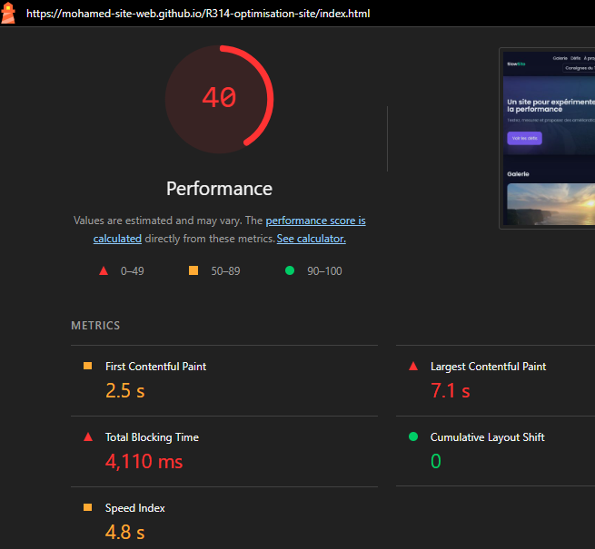
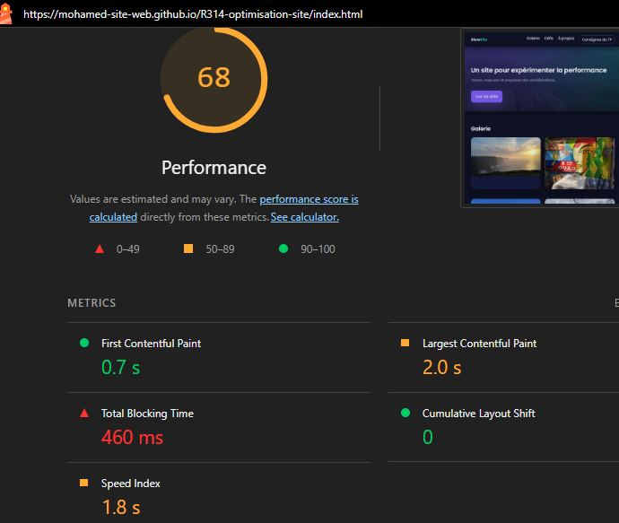

# Rapport d’optimisation — SlowSite

Mohamed Bouaziz — BUT MMI — R3.14

Site : https://mohamed-site-web.github.io/R314-optimisation-site/

Dépôt : https://github.com/mohamed-site-web/R314-optimisation-site

## 1. Audit initial et conditions de mesure

L’objectif du TP est de rendre SlowSite plus rapide en conservant son apparence et ses fonctionnalités.

Les mesures ont été réalisées sur le site publié sur GitHub Pages. Dans Réseau, le cache était désactivé et les ressources étaient triées par taille. Le relevé final a été effectué après défilement pour charger aussi les images différées. Les tailles en MB sont reprises telles qu’elles sont affichées par le navigateur.

Pour les audits Lighthouse finaux, j’ai utilisé les profils Mobile et Ordinateur en navigation privée, sans le widget ?perf=1. Les trois scores Mobile initiaux étaient 25, 27 et 26. La capture retenue correspond au score médian de 26. Pour les relevés finaux, j’ai effectué trois essais par profil et calculé la médiane de chaque indicateur séparément. La capture Ordinateur initiale disponible constitue un relevé unique, et non une médiane de trois essais documentés ; ses conditions initiales ne sont pas entièrement documentées.

Le panneau Performance a été utilisé avec un ralentissement CPU ×4 et des enregistrements avec défilement d’au moins 20 secondes. Des sessions sans défilement ont aussi permis de comparer le script différé sur fenêtre large et étroite. Coverage a servi à repérer le CSS inutilisé, avec une vérification des fichiers HTML et JavaScript avant suppression.

Au départ, Réseau indiquait 17,5 MB pour 22 requêtes. Les images représentaient l’essentiel du poids.

PageSpeed Insights donnait aussi des LCP élevés : 67,1 s sur Mobile et 12,1 s sur Ordinateur. Les captures sont conservées dans audit/Insights.png et audit/Insights-pc.png. Ces résultats ne sont pas mélangés avec Lighthouse dans le tableau, car les conditions sont différentes. Aucune donnée de terrain sur les visiteurs n’était disponible : l’audit repose sur des données de laboratoire.

## 2. Problèmes, corrections et résultats

### Images et téléchargements inutiles

Les images étaient trop lourdes. J’ai réduit les six images, utilisé WebP et ajouté des variantes de 760 pixels avec srcset et sizes, selon la grille responsive. Les pages de détail conservent les images plus grandes. La règle max-width:100%;height:auto évite leur débordement sur petit écran.

Après réduction des images, le total est passé de 14,2 à 7,4 MB. Le passage en WebP seul n’a pas apporté de gain : le relevé suivant affichait 7,6 MB. L’optimisation du fond a ensuite réduit son transfert d’environ 3,39 MB à 788 kB et le total à 5 MB. Avec les variantes adaptées à la galerie, un relevé affichait environ 2,09 MB. Ces étapes sont documentées dans les captures Réseau intermédiaires du dossier audit/.

Le préchargement de img6.jpg?v=2 provoquait un téléchargement supplémentaire. Sa suppression a fait passer le poids de 17,5 à 14,2 MB et les requêtes de 22 à 21, soit environ 3,3 MB économisés. Le retrait de la référence au script absent js/legacy/polyfills.js a ensuite réduit les requêtes à 20. Les preuves sont audit/Reseau-apres-prel.png et audit/Reseau-apres-poly.png.

J’ai ajouté width et height aux images pour réserver leur place. Les CLS relevés après cette étape étaient 0, 0,034 et 0,011 : la médiane de 0,011 ne montrait pas encore de gain par rapport au Mobile initial. J’ai aussi ajouté decoding="async" et loading="lazy" aux dernières images. Le chargement différé décale les transferts sans réduire le poids total une fois toutes les images chargées.

### Chargement des scripts, du CSS et des polices

J’ai ajouté defer aux scripts en conservant leur ordre, remplacé les imports CSS par des liens HTML et regroupé le chargement des polices avec display=swap. J’ai aussi retiré une indication DNS inutile.

Après defer, les médianes Mobile étaient FCP 3,3 s, LCP 8,3 s, TBT 10 690 ms et CLS 0. Ce résultat intermédiaire comprend les optimisations d’images précédentes et ne mesure donc pas le gain de defer seul. La capture est audit/Lighthouse-mobile-apres-defer.png.

### Suggestions et calculs pendant le défilement

buildKeywordIndex utilisait innerHTML += dans une boucle. J’ai construit toutes les options avant une seule insertion. Les suggestions sont conservées. La fonction n’apparaissait plus parmi les principales activités du relevé suivant, sans que cela signifie un temps nul.

Dans revealCards, la hauteur maximale était recalculée dans une boucle imbriquée. Les lectures de dimensions et les écritures de styles étaient mélangées, ce qui favorisait les reflows forcés. J’ai supprimé les calculs répétés, séparé les lectures des écritures et regroupé les mises à jour avec requestAnimationFrame.

Un relevé après correction affichait environ 539 ms de temps total pour revealCards, contre 6 327 ms au départ. Les défilements n’étant pas identiques, ce sont des ordres de grandeur. Les preuves sont audit/Performance-apres-suggestions.png, audit/Performance-apres-revealCards.png et les profils initiaux.

### Bibliothèque UIKit et observateur

UIKit exécutait une attente active et créait un grand tableau inutilisé au démarrage. Son MutationObserver relisait les styles de toute la page après les modifications, notamment pendant le défilement.

J’ai retiré les calculs inutilisés, puis remplacé les helpers par les fonctions JavaScript natives. Le retrait d’UIKit a aussi supprimé l’observateur inutile, en conservant les interactions. Les appels _sync n’apparaissaient plus parmi les principales activités du profil suivant. La preuve est audit/Performance-apres-retrait-uikit.png.

### Calcul différé et conditionnel dans analytics.js

Le calcul commençait environ 9,1 secondes après le chargement, puis revenait toutes les 2,6 secondes. Il ne travaillait que sur une page visible de plus de 1 024 pixels de large. Sa boucle occupait progressivement le processeur pendant 46 à 430 ms par appel.

Les chaînes base64 masquaient innerWidth, performance, now et hidden. Leur décodage et les profils ont permis de comprendre le problème. Sur grand écran, _tick cumulait environ 3,94 s sur la plage affichée. En fenêtre étroite, la fonction revenait immédiatement et représentait environ 0,6 ms.

J’ai remplacé la boucle par un seul calcul par appel, en conservant le minuteur et les conditions. Après correction sur grand écran, _tick représentait environ 97 ms sur la plage affichée et les gros pics réguliers avaient disparu. Ces temps de profil ne sont pas le TBT Lighthouse.

### Nettoyage et minification du CSS

Coverage indiquait 95,8 % de code inutilisé dans styles.css et 99,5 % dans extra.css. Après vérification des pages et des scripts, j’ai supprimé les classes inutilisées redundant-*, extra-*, legacy-*, tile* et highlight. Les règles nécessaires aux images, au calendrier et aux petits écrans ont été conservées.

Le code de styles.css est passé de 91 998 à 4 348 octets, celui d’extra.css de 28 798 à 142 octets et celui de theme-legacy.css de 1 142 à 299 octets. Coverage n’indiquait plus que 10,9 % d’inutilisé dans styles.css. Ces tailles concernent le code décompressé, pas le transfert réseau.

J’ai conservé les ombres et le flou : le profil ne permettait pas d’isoler leur coût. J’ai limité la transition du bouton à transform, en gardant son ombre au survol. Les autres transitions utilisent déjà transform ou opacity. Aucun gain chiffré propre à ce changement n’est annoncé.

Enfin, j’ai minifié les trois feuilles CSS. Le relevé publié affichait 1,8 kB pour styles.css, sans permettre d’isoler le gain de la minification. La preuve est audit/Reseau-apres-minification-css.png.

## 3. Comparaison finale

Les valeurs Lighthouse « Avant » viennent des captures initiales : l’essai au score médian pour Mobile et le relevé disponible pour Ordinateur. Les valeurs « Après » sont les médianes de chaque indicateur sur trois essais par profil. Les captures représentatives peuvent donc afficher une valeur différente de certaines médianes.

Le poids et les requêtes proviennent de relevés Réseau séparés. Ils ne sont pas présentés comme des mesures propres à chacun des deux profils Lighthouse. La comparaison réseau dépend aussi du format d’écran, puisque srcset adapte les images téléchargées.

La mise en forme de ce tableau a été générée avec une IA pour faciliter la lecture. Les chiffres proviennent des relevés d’audit.

Les scores finaux étaient 40, 42 et 39 sur Mobile, soit une médiane de 40. Sur Ordinateur, ils étaient 56, 74 et 68, soit une médiane de 68. Les variations, notamment du TBT, montrent l’intérêt des trois essais.

## 4. Limites et bilan

Le relevé Réseau final affiche environ 88 % de poids transféré en moins et quatre requêtes en moins. Les captures Lighthouse montrent aussi un affichage du contenu principal plus rapide. Le résultat Mobile reste à améliorer : le LCP médian est encore de 10,5 s et le TBT de 2 670 ms. Le favicon, encore lourd, constitue également une piste restante.

Les corrections ont porté sur les ressources et les traitements, en conservant la galerie, ses liens, le filtre, les suggestions et le calendrier. Les temps Performance dépendent du défilement et les premiers relevés ne documentent pas tous une série complète de trois essais. Ces limites empêchent d’attribuer un gain exact à chaque modification.

Le site étant hébergé sur GitHub Pages, certains réglages serveur ne sont pas directement accessibles. D’après le guide, gzip y est déjà appliqué aux fichiers texte. Sur un serveur configurable, je vérifierais gzip ou Brotli, un cache long pour les ressources versionnées et une revalidation courte pour le HTML. Un outil de build pourrait ajouter une empreinte aux noms des fichiers pour renouveler le cache à chaque version. Je vérifierais aussi HTTP/2 ou HTTP/3 et l’utilisation d’un CDN. Ces pistes ne sont pas présentées comme des corrections réalisées ni comme des gains mesurés dans ce TP.