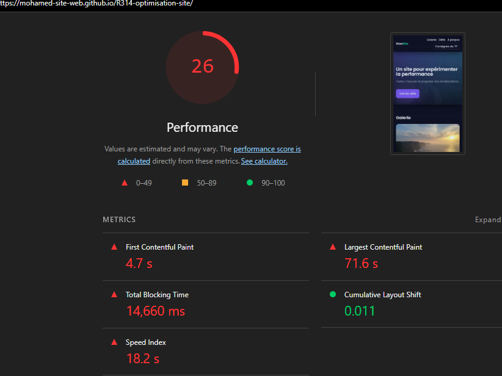
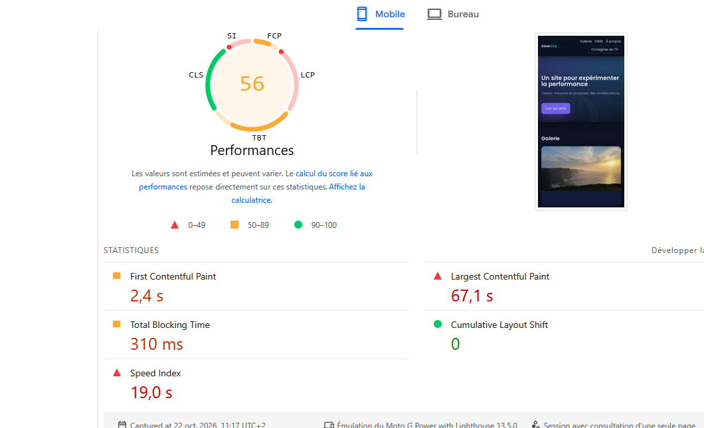
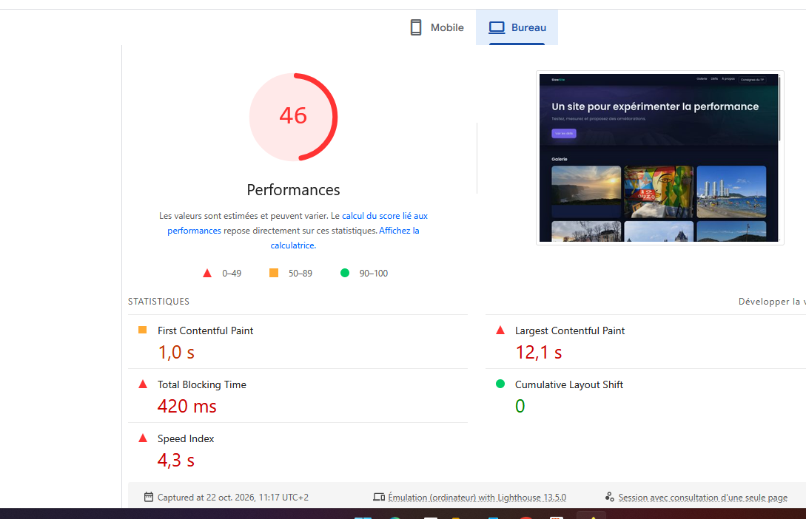
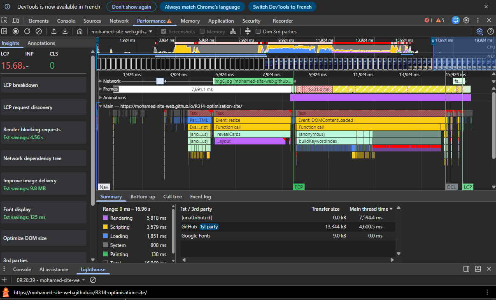
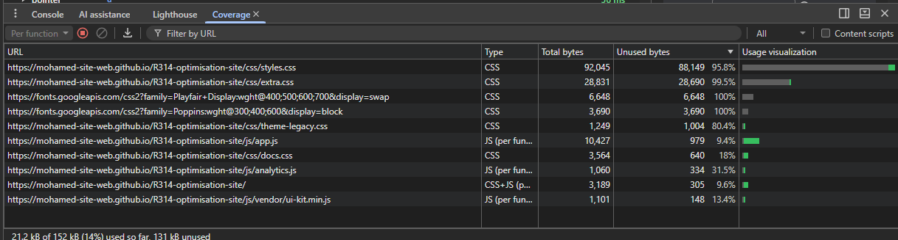
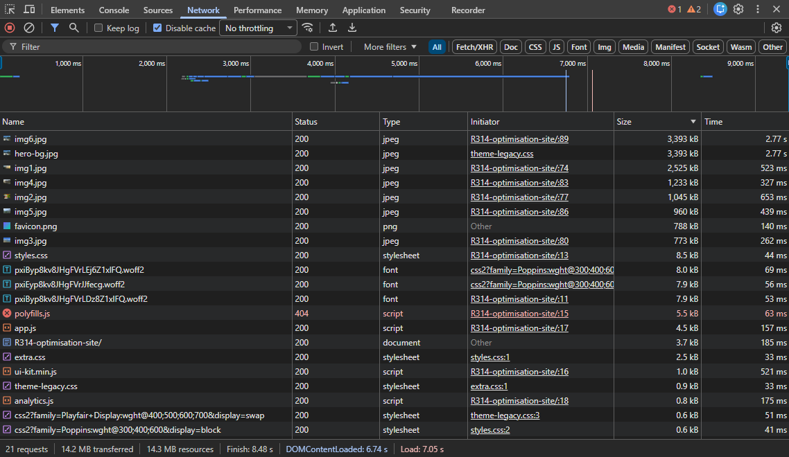

# Rapport d’optimisation — SlowSite

Mohamed Bouaziz — BUT MMI — R3.14

Site : https://mohamed-site-web.github.io/R314-optimisation-site/

Dépôt : https://github.com/mohamed-site-web/R314-optimisation-site

## 1. Audit initial

L’objectif est de rendre SlowSite plus rapide en gardant la même apparence et les mêmes fonctionnalités.

Les relevés portent sur le site publié sur GitHub Pages. Pour Réseau, le cache est désactivé et les fichiers sont triés par taille.

Le test Lighthouse Mobile a été réalisé en navigation privée. Les trois scores obtenus sont 25, 27 et 26. J’ai retenu l’essai à 26/100, qui correspond au score médian.

Les séries de trois essais des autres profils restent à documenter. Pour Performance, le réglage CPU ×4 et la durée complète d’au moins 20 secondes avec défilement restent à confirmer. Le relevé Lighthouse Ordinateur reste provisoire tant que ses conditions sans extensions ne sont pas confirmées.

### Réseau

Le site transfère 17,5 MB pour 22 requêtes. Les images représentent l’essentiel du poids : plusieurs dépassent 1 MB et certaines atteignent environ 3,39 MB.

### Lighthouse

Sur Mobile, le résultat retenu est de 26/100 :

- FCP : 4,7 s.
- LCP : 71,6 s.
- TBT : 14 660 ms.
- CLS : 0,011.

Le contenu principal apparaît très tard et le thread principal reste longtemps bloqué pendant le chargement.

Sur Ordinateur, la capture disponible affiche 29/100 :

- FCP : 1,6 s.
- LCP : 11,3 s.
- TBT : 3 780 ms.
- CLS : 0,065.

### PageSpeed Insights

Sur Mobile, le score est de 56/100 :

- FCP : 2,4 s.
- LCP : 67,1 s.
- TBT : 310 ms.
- CLS : 0.

Sur Ordinateur, le score est de 46/100 :

- FCP : 1 s.
- LCP : 12,1 s.
- TBT : 420 ms.
- CLS : 0.

Ces résultats montrent surtout un chargement lent du contenu principal. Les mesures de Lighthouse sur mon ordinateur et celles de PageSpeed ne sont pas directement comparables, car leurs conditions sont différentes.

L’audit repose sur des données de laboratoire. Je ne dispose pas de données de terrain sur les visiteurs.

### Performance et Coverage

La frise montre plusieurs tâches longues. Dans Bottom-up, `revealCards` représente environ 6 327 ms de temps total et `buildKeywordIndex` environ 3 232 ms. Ces temps incluent les fonctions appelées et ne doivent pas être additionnés.

Coverage indique une forte proportion de CSS inutilisé pendant la session :

- `styles.css` : 95,8 %.
- `extra.css` : 99,5 %.
- `theme-legacy.css` : 80,4 %.

Il faudra vérifier les autres pages et interactions avant de retirer des règles.

## 2. Problèmes identifiés et corrections proposées

Les emplacements correspondent au code avant modification. Les corrections suivantes ne sont pas encore appliquées.

### Images et favicon trop lourds

Dans `index.html`, lignes 75 à 90, la galerie utilise des images volumineuses. Le fond déclaré dans `css/theme-legacy.css:10` pèse aussi environ 3,39 MB. Le favicon, appelé dans `index.html:8`, représente environ 788 kB.

Ces poids sont visibles dans la capture Réseau.

Je propose de compresser les images et d’adapter leurs dimensions à leur utilisation, en gardant une qualité suffisante. Le favicon peut aussi être remplacé par une version plus légère.

### Téléchargement supplémentaire

Dans `index.html:12`, le site précharge `img6.jpg?v=2`, alors que la galerie utilise `img6.jpg` à la ligne 90. Réseau montre deux transferts d’environ 3,39 MB chacun.

Je propose de retirer ce préchargement s’il n’est pas utile au premier affichage. L’économie réelle sera vérifiée après publication.

### Images sans dimensions

Les images de la galerie, dans `index.html:75–90`, n’ont pas d’attributs `width` et `height`. Les diagnostics le signalent également.

Cela peut provoquer des déplacements de contenu, même si le CLS est nul sur les essais PageSpeed disponibles.

Je propose d’ajouter les dimensions réelles tout en gardant les images responsives.

Preuve : [capture des diagnostics](audit/dianostic.png).

### Construction des suggestions coûteuse

Dans `js/app.js:74–82`, `buildKeywordIndex` utilise `innerHTML +=` dans une boucle. Cela reconstruit plusieurs fois le contenu du datalist.

Bottom-up attribue environ 3 232 ms de temps total à cette fonction.

Je propose de construire toutes les options avant de les insérer en une seule fois.

### Calculs répétés pendant le défilement

Dans `js/app.js:158–187`, `revealCards` mélange lectures de dimensions et modifications de styles. La hauteur maximale des cartes est recalculée dans une boucle imbriquée.

Le profil Performance montre beaucoup de temps passé dans cette fonction et dans les calculs de mise en page.

Je propose de regrouper les lectures avant les écritures et de limiter les calculs répétés pendant le défilement, tout en gardant les animations.

### Bibliothèque JavaScript coûteuse

Le diagnostic PageSpeed attribue 963 ms de CPU à `js/vendor/ui-kit.min.js`, contre 1 288 ms à `js/app.js`.

À la ligne 2 du fichier minifié, le code contient une attente active, de nombreuses allocations et un mécanisme qui relit les styles de tous les éléments après des modifications.

Je propose de conserver les fonctions utiles et de limiter les traitements inutiles, puis de mesurer le résultat.

### CSS et dépendances

Les imports au début de `styles.css`, `extra.css` et `theme-legacy.css` créent une chaîne de chargement. Coverage montre aussi beaucoup de règles inutilisées pendant la session.

Je propose de simplifier les dépendances et de retirer seulement les règles dont l’inutilité a été vérifiée sur les pages et les formats d’écran concernés.

Le gain réseau devra être mesuré sur le site publié, où les fichiers texte sont compressés.

### Piste conditionnelle à tester

Le code de `js/analytics.js` contient un calcul périodique qui s’active après un délai, seulement si la page est visible et plus large que 1 024 pixels. Sa durée augmente avec les passages.

Cette piste reste à confirmer avec un enregistrement long, puis une comparaison entre fenêtre large et étroite. Aucun gain n’a encore été mesuré pour ce point.

## 3. Corrections et résultats avant/après

Les corrections n’ont pas encore été réalisées.

Le tableau rassemble les six indicateurs demandés. Les temps viennent de PageSpeed Insights. Le poids et les requêtes viennent d’un relevé Réseau séparé, commun aux deux profils de départ.

### Suppression du préchargement supplémentaire

J’ai retiré de `index.html` le préchargement de `img6.jpg?v=2`. L’image reste présente dans la galerie avec l’adresse `img6.jpg`.

Après publication, le poids transféré passe de 17,5 à 14,2 MB, soit environ 3,3 MB économisés (19 %). Le nombre de requêtes passe de 22 à 21.

### Suppression de la référence au script absent

J’ai retiré la référence à `js/legacy/polyfills.js`, qui renvoyait une erreur 404. Le nombre de requêtes passe de 21 à 20. Le poids transféré reste à 14,2 MB à l’arrondi affiché.

Après chaque optimisation, je noterai :

- Le problème et sa preuve.
- La correction appliquée.
- Le commit correspondant.
- Les mesures après correction.
- Le gain mesuré.

Les mesures seront refaites sur le site publié dans les mêmes conditions. Je comparerai aussi l’apparence et testerai la galerie, le filtre, les suggestions, les animations et le calendrier.

Les colonnes « Après » seront complétées avec ces résultats.

## 4. Bilan provisoire

Les principaux problèmes concernent le poids des images et le travail JavaScript.

Je commencerai par les ressources lourdes, puis les traitements JavaScript et le CSS. Les captures avant et après permettront de vérifier les gains et de confirmer que le rendu du site reste identique.